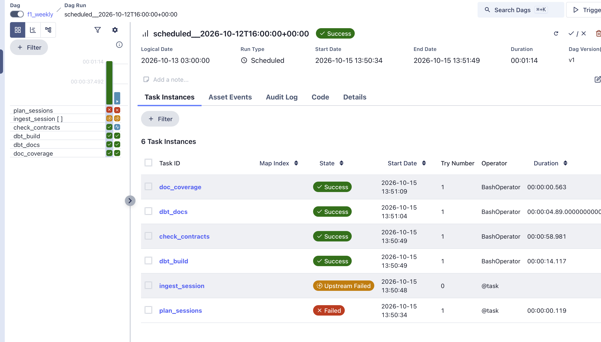
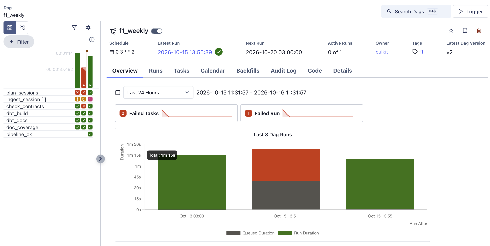

# F1 Pitwall


Race-strategy analytics for Formula 1 on a local Parquet lakehouse: a resumable ingestion pipeline with an audit log, a tested dbt transformation layer (typed silver tables, gold dimensions and facts with enforced contracts, reconciliation against official results), a validated race-state engine, strategy models with measured accuracy (including a pit-stop rejoin predictor scored on races it was not fitted on), a Streamlit app with a race scrubber, and a static web app with telemetry, sector, predictor, practice and replay pages.

<!-- readme-v2 -->

> **Unofficial.** This project is not associated with the Formula 1 companies. F1, FORMULA ONE, FORMULA 1, GRAND PRIX and related marks are trade marks of Formula One Licensing B.V. Data comes from the public timing feed via [FastF1](https://github.com/theOehrly/Fast-F1) and from the [Jolpica](https://github.com/jolpica/jolpica-f1) Ergast-compatible API. The raw feed data, the lake and the database are not in this repository. It does include derived JSON that the web app reads under `web/public` (lap and sector times, season results, pit-stop scores, predictor scores); I have not confirmed that publishing that is permitted. See Data terms. Personal, non-commercial use.

<!-- TODO: add docs/screenshots/{predictor,drivers,telemetry,replay}.png and reference them here -->

## What it does

- **Ingests** race-weekend data one session at a time (laps, sectors, tyres, weather, race control, track status, car telemetry and GPS position at about 3.8 Hz) into partitioned Parquet files, and 1950-to-now results and standings from Jolpica. Every attempt is written to an ingest log.
- **Transforms** the lake with dbt (DuckDB): typed and deduplicated silver tables, gold dimensions and facts with enforced data contracts, and tests that compare the pipeline's output with the official classification and with its own log.
- **Checks** every table it writes against data contracts (structure as hard failures, value ranges as logged findings) and records per-session quality metrics (value ranges, sampling gaps, circuit metadata) in the log.
- **Reconstructs the race** from GPS: a running order and time gaps for every car at any moment, validated against the official sector timing.
- **Models pit stops**: the time lost in the pit lane, and where a driver rejoins, backtested on real stops.
- **Serves it** in a Streamlit app (race explorer, track map, driver and multi-driver telemetry, race gaps, pit window, a race scrubber with auto-play, a session timing screen, a 1950-to-now history browser) and through a read-only API.
- **Publishes it** as a static web app: telemetry against distance, sector colours, a pit-stop predictor scored on held-out races, practice long runs and a race replay. No server is needed; the pages read JSON that exporters write from the gold tables.

## Why it exists

Most F1 tools are viewers: they show the timing screen. This project asks a narrower question: *how well can the numbers on that screen be reconstructed and used for strategy decisions, and how do we know?* Every derived number here comes with a test against something independent (official sector timing, official classification, real pit stops), and the limits are written down.

## Architecture

```
FastF1 (timing + telemetry) ──┐
                               ├─► ingest.py / batch.py ─► Parquet lake ─► dbt (DuckDB) ─► gold tables ─► Streamlit app
Jolpica API (1950-now) ───────┘      (rate-limit aware,     data/lake/      silver -> gold     contracts      (read-only)
                                      resumable, one          year=/round=/   + reconciliation   + tests
                                      session at a time)      session=/
                                           │
                                           └─► _manifest/*.jsonl (ingest log) ─► dbt run metadata, report.py, verify.py
```

| Layer | Choice |
|---|---|
| Language | Python 3.11 |
| Sources | FastF1 3.8 (timing, telemetry), Jolpica (history) |
| Storage | Parquet (zstd), Hive-style partitions, JSONL ingest log |
| Transform | dbt-core 1.12 with dbt-duckdb, models read the lake in place |
| Query | DuckDB (embedded), pandas, NumPy |
| App | Streamlit 1.65, Plotly |
| CI | GitHub Actions: unit tests and syntax lint, a full dbt build on a synthetic lake, and a documentation coverage gate |
| Checks | pandera data contracts at ingest (`contracts.py`), dbt tests and contracts, `verify.py` (file vs log), `report.py` (coverage and problems) |
| Reproducibility | Exact dependency versions per environment in `constraints/`, regenerated by `scripts/freeze_constraints.sh` |
| Orchestration | Apache Airflow 3.3 in Docker Compose (LocalExecutor, Postgres), one weekly DAG, ingest and dbt in separate virtualenvs in the image |

There is no warehouse server. That was deliberate: an earlier version of this project ran on a warehouse trial that expired and took its dashboard with it. Everything here runs from files, and Airflow (local, in Docker) only schedules the same commands you can run by hand (see Orchestration).

## Data

**Coverage**

| Tier | Years | Content |
|---|---|---|
| Results, standings, drivers, teams, circuits | 1950 - 2026 | Jolpica |
| Full detail | 2022 - 2026 | Races, qualifying, sprints, sprint qualifying: laps, sectors, tyres, weather, race control, track status, car telemetry, GPS position |
| Laps only | Practice sessions, 2022 - 2026 | No telemetry |
| Timing without telemetry | 2018 - 2021 | Races and qualifying only (no practice, no 2021 sprints): laps, tyres, weather, race control, track status |

Sessions loaded completely: 706 (2018: 41, 2019: 42, 2020: 34, 2021: 44, 2022: 110, 2023: 110, 2024: 120, 2025: 120, 2026: 85), plus one 2018 race for which FastF1 provides no laps (see known data gaps). Total about 1.8 GB on disk.

**Typical size per session** (zstd Parquet): race with telemetry 9-16 MB, qualifying 4-5 MB, sprint 4-7 MB, practice (laps only) about 0.1 MB.

**Lake layout**

```
data/lake/
  laps/ telemetry_car/ telemetry_pos/ weather/ race_control/ results/
  circuit_corners/ circuit_marshal_sectors/ track_status/ session_status/
     year=YYYY/round=RR/session=CODE/part.parquet
  history/   results, driver_standings, constructor_standings, drivers, constructors, circuits
  _manifest/ sessions.jsonl (one record per ingest attempt), backfill.jsonl (one per backfill attempt)
data/f1_dbt.duckdb                       dbt output (silver and gold schemas)
```

Round numbers follow FastF1's numbering for the season. They do not always match the official calendar (the 2026 calendar was changed), so history tables are never joined to sessions by round number. The 2023 sprint qualifying session is stored as `SS`.

## Ingestion

- **One session at a time**, written then recorded in the ingest log, so an interrupted run loses at most the session in progress.
- **Rate limits.** FastF1 limits itself to about 500 requests an hour (200 for ergast.com hosts), counted in a sliding window inside the Python process; it raises an error when the window is full. The batch runner detects this, waits in 5-minute steps (up to 30 in a row; the first runs used 15-minute steps), and retries. Observed over 15 waits in the full ingest: a burst of 20-82 sessions (median 40), then a wait of 17-61 minutes (median 50) before ingesting resumes. Runs of 60, 103 and 106 sessions took 1 h 13 min, 3 h 35 min and 2 h 40 min unattended; the last overnight run (332 sessions, 2022-2024 practice plus 2018-2021 races and qualifying) took 7 h 39 min, about six hours of it waiting. The median session takes 16 seconds to ingest, so the rate limit, not the work, sets the wall-clock time.
- **Resumable.** Finished sessions are skipped; `--retry-failed` redoes failures; `--dry-run` prints the plan.
- **Scratch cache** is deleted after every session, so disk use stays flat.
- **Status per session:** ok, partial or failed, with the reason.
- **Data contracts** (`contracts.py`, pandera) are checked on every table before it is written. Hard rules (required columns, key columns not null, numeric columns numeric) fail the table, which is then recorded as failed in the ingest log. Soft rules (plausible value ranges, known code sets) never block a write: findings are stored on the log record and printed in the session report, and a rule only fires when more than its tolerance of the rows break it. The rules were derived from a profile of the whole lake, not guessed, and `scripts/check_contracts.py` validates the eight main tables across the whole lake against them: no hard failures, and no soft findings once two rules were set from the data (throttle is 0-100 or the code 104; gear above 8 is tolerated up to 0.5% of rows, see the raw-feed findings below).
- **A launcher script** refuses to start a second run. (An accidental double launch early on made two runs collide on the shared cache; `verify.py` was written to prove nothing was damaged. It found nothing, and the duplicate log lines are harmless.)
- **Backfill.** `scripts/backfill_track_status.py` adds `track_status` and `session_status` to sessions that were ingested before those tables existed (206 sessions in 2019, 2025 and 2026). It only writes the missing tables, skips sessions that already have them, and logs to `backfill.jsonl`.

## Transformation layer (dbt)

Run from the repository root: `dbt build --project-dir dbt --profiles-dir dbt`. The models read the Parquet lake in place and write a DuckDB file under `data/`.

| Layer | Models | What happens |
|---|---|---|
| Sources | `lake.*`, `history.*`, `manifest.runs` | Parquet files and the JSON ingest log, with not-null checks on key columns |
| Silver (11) | laps, results, race control, weather, track status, sessions, session clock, three history tables, ingest runs | Typed columns, duplicates removed, explicit keys such as `session_key = 2025-R07-R` |
| Gold (42) | `dim_circuit`, `dim_constructor`, `dim_driver`, `dim_historical_driver`, `dim_layout_length`, `dim_session`, `dim_session_circuit`, `fct_circuit_degradation`, `fct_circuit_pit_loss`, `fct_constructor_points_progression`, `fct_constructor_standing`, `fct_driver_standing`, `fct_ingest_session`, `fct_ingest_summary`, `fct_lap`, `fct_lap_gap`, `fct_lap_position`, `fct_lap_sample`, `fct_lap_sample_total`, `fct_lap_sector`, `fct_lap_trace`, `fct_lap_trace_lap`, `fct_pit_loss`, `fct_pit_loss_neutralised`, `fct_pit_loss_ratio`, `fct_pit_now`, `fct_pit_now_check`, `fct_pit_prediction_check`, `fct_pit_prediction_heldout`, `fct_pit_prediction_heldout_score`, `fct_pit_prediction_score`, `fct_pit_stop`, `fct_points_progression`, `fct_race_control_event`, `fct_race_control_period`, `fct_result`, `fct_season_result`, `fct_session_weather`, `fct_stint`, `fct_stint_degradation`, `fct_stop_battle`, `fct_track_status_period` | Facts and dimensions that the exporters, the API and the app read |
| Reconciliation (4) | `rec_finish_order`, `rec_lake_vs_manifest`, `rec_weekend_coverage`, `rec_telemetry_coverage` | The pipeline checked against official results and against its own log; telemetry checked against the laps table |

The last build had 258 steps: 57 models, 1 seed and 200 tests. Result: 251 passed, 7 warnings, 0 errors. The warnings are `finish_order_reconciles`, `lap_sector_sum_matches_lap`, `lap_trace_coverage`, `pit_lane_time_plausible`, `pit_loss_plausible`, `session_missing_laps`, `telemetry_coverage_flags`. 26 gold models have enforced contracts (declared column names and types that the build checks).

**Race control periods.** `fct_race_control_period` holds safety car, VSC and red flag periods read from the wording of the race control messages. It is a SQL version of `build_periods` in `app/racecontrol.py`, which stays as the reference. Over the 269 sessions that have a session clock it gives 264 periods, identical to the Python (`experiments/rc_periods_reconcile.py`). The 438 older sessions get periods in UTC only and are not compared against the Python on real data. The session clock (`silver_session_clock`) comes from lap start dates and equals the position-sample clock the app uses in all 269 sessions (`experiments/rc_offset.py`). Messages in the same second are common (478 of 707 sessions), but ordering them differently changed no period (`experiments/rc_ties.py`). Against the separate track status feed, 262 of 264 periods start within 5 s of a matching change (median 0.3 s). The two exceptions: a VSC message about ten minutes after the last lap of the 2022 French GP, and a second "safety car deployed" message 8 s after "in this lap" in the 2026 British GP, which starts a new period 540 s after the nearest status change, inside what the status feed shows as one continuous safety car. The cause of either is not known.

**Telemetry coverage.** The two telemetry tables (139.5 million car rows and 142.2 million position rows over 269 sessions) are declared as sources, and `rec_telemetry_coverage` checks them against the laps table in 1.4 s. Telemetry is expected for every session except practice: all 269 qualifying, race and sprint sessions from 2022 on have both tables, and none of the 276 practice sessions has either. The median sample rate is 3.74 Hz for car data and 3.82 Hz for position. In 23 sessions telemetry has more drivers than the laps table; the results table accounts for 19 of the 30 extra drivers (16 did not start, one retired, one withdrew, one had an accident), 9 are in qualifying sessions where the status is blank, and 2 are in races with a blank status. The test `telemetry_coverage_flags` warns on two sessions (listed under known data gaps). Its tolerances (60 s, 3 Hz) were set just outside the range seen in this lake, so they say what is unusual here, not what is wrong in general.

**Documentation.** Every model and every column has a description, written from the model SQL; where a meaning could not be verified, the description says so. `dbt docs generate` builds the catalog and the lineage graph (`dbt docs serve --project-dir dbt --profiles-dir dbt` to browse it). `scripts/doc_coverage.py --check` reads dbt's own artifacts and fails if any model, or any column of a gold model, lacks a description. CI runs it after the synthetic-lake build, so the coverage cannot slip silently.

**What the reconciliation found**

| Check | Result |
|---|---|
| Lap counts of classified finishers against the official classification | Match in 3,116 of 3,183 classified finishers (67 mismatches; 65 of them are in the four races whose lap counts disagree, listed under known data gaps below) |
| Finishing order derived from laps against the official order | Exact position match turned out to be a poor metric: post-race penalties shift official positions. The test now compares the order of classified finishers pairwise and flags races with at least 10 finishers that fall below 90% agreement or have more than one lap-count mismatch. Ten races are flagged, all listed under known data gaps below: four have penalty events in race control (whether they explain the order is untested), two have low order agreement and no recorded penalty, and four have lap counts that disagree with the official classification |
| Pit lane time (timed lane transit) for green-flag race stops | Median about 23 s. Different from the 22.4 s pit *loss* used in the strategy models below, which includes the in-lap and out-lap. Two stops fall outside the 5-300 s plausibility window (one in the 2026 round 1 race, one in the 2026 round 12 sprint); neither is a red flag, cause unknown (see known data gaps) |
| Lake files against the ingest log, five tables per session | Row counts agreed for every session at the last build |
| Race weekends against the expected set of sessions | No gaps. A session counts as present if any of its tables has data, so this check does not see the 2018 Italian GP race (results but no laps). Expected sessions by weekend format are my reading of FastF1's session names |
| Sessions with results but no laps | One: the 2018 Italian GP race (`session_missing_laps`) |

**Known data gaps**

Every warning left in the build is listed here, with what was measured and what is still unexplained.

| Session | What the data shows | Status |
|---|---|---|
| 2018 Italian GP, race | FastF1 reports "Failed to load timing data" and the failure repeated on a retry. Results, weather, race control and track status are in the lake; laps are not | Source gap, caught by `session_missing_laps` |
| 2021 Belgian GP, race | Red flags on lap 1 and lap 3. The classification counts 1 lap, the laps table has 3 | Explained by the red flags (not checked against the sporting rules) |
| 2020 Austrian GP, race | The laps table ends at lap 68 for the winner and 67 for most others; the classification and the chequered flag say 71. No red flag in race control | Gap in the source timing laps |
| 2019 Japanese GP, race | The laps table has 53 laps for the winner, the classification 52. Race control logs the chequered flag twice, at lap 53 | Cause unknown |
| 2018 Canadian GP, race | The source classification gives the winner 68 laps, the laps table has 70, race control logs the chequered flag at lap 70 | Cause unknown |
| 2018 Bahrain GP and 2019 German GP, races | Pairwise order agreement 88.2% and 87.2%; lap counts match; no penalty events in race control | Cause unknown |
| 2023 Australian GP, 2024 and 2025 Miami sprints, 2026 Monaco GP | Order agreement 76-90%; race control holds penalty events (1, 6, 1 and 15) | Penalties are the candidate cause; not tested |
| 2026 round 1 race (STR, lap 34) and round 12 sprint (HUL, lap 5) | One car spends 18 and 21 minutes between pit entry and pit exit (1,082 s and 1,270 s). The track status has no red flag, and only one driver has a long lap at those lap numbers | Cause unknown: a long garage stop or a timing artefact. A third long lap (lap 13, 1,070 s, same race) was not flagged by the plausibility check |
| 2024 British GP, race (ZHO, lap 26) | A stop with a measured pit loss of 1.3 s, below the 5 s plausibility floor. The driver's median gap to the field over the eight laps around the stop was 6.8 s, which the method subtracts from the in-lap and the out-lap | Cause unknown (`pit_loss_plausible`). Changing track conditions around the stop are a candidate; not tested |
| 2026 Monaco GP, race | Position telemetry ends 5,233 s (87 minutes) before the last lap and averages 1.2 samples per second against about 3.8 elsewhere; car telemetry is complete | Source gap, caught by `telemetry_coverage_flags`; cause unknown |
| 2023 round 17, sprint shootout | Car and position telemetry both start 78 s after the first lap began | Source gap, caught by `telemetry_coverage_flags`; cause unknown |

For the four lap-count cases I compared the raw Parquet files with the gold tables for the winner: the row counts agree, so the transformation does not lose laps and the disagreement is between the source's timing laps and its classification. The explanations above are readings of this data, not confirmed against official documents.

**Data problems the tests found, and what was done**

- **Garage visits** in qualifying and practice were counted as pit stops (4,466 false warnings). Pit-stop plausibility now applies to race sessions only.
- **Red-flag laps** (Monaco 2024 lap 1) triggered lap-time warnings; laps under a red flag are excluded from that check.
- **Shared drives**: in 1950-1964 a driver could take over another car in the same race, which gave 71 duplicate result keys. `fct_season_result` now numbers the extra drives (`drive_number`) and suffixes the key.
- **Missing driver ids**: FastF1 gives `nan` or an empty id for some drivers (Bearman, Piastri, and practice-only drivers in 2025-2026, 59 session rows). The id is filled from the Jolpica history by season and driver code; drivers who have never raced get a placeholder id `ff1-<code>`, and `driver_id_source` records which rule applied. FastF1 also writes missing names as the text `None None`; those become null.

CI builds the same project on a small synthetic lake (`dbt/ci/make_ci_lake.py`) that contains deliberate bad rows: a duplicate lap, a null lap number, a `nan` driver id, a practice-only driver, a shared drive, and a log that the lake must match. The real data is not needed in CI.

## What the data-quality checks found (raw feed)

| Finding | Handling |
|---|---|
| Car telemetry runs at about 4 Hz (0.24 s median step), with feed gaps of 1.4-1.8 s | Interpolate within gaps; flag long gaps |
| Throttle reads 104 in about one sample in five (19-25% of samples per season; every one of the 269 sessions with telemetry has some, up to 65% of a session). 104 is the only value above 100, so it looks like a code, not a percentage; its meaning is not verified | Stored raw, clamped to 100 for display, accepted by the data contract as the code 104 |
| Gear above 8 (values from 9 up to 128) in a tiny share of samples: 96 of 269 sessions, median 0.01% of the session's samples, worst 0.17% | Stored raw, counted; the data contract tolerates up to 0.5% of rows |
| DRS is always 0 in 2026 (DRS was removed); 2025 uses codes 0, 1, 2, 3, 8, 10, 12, 14. Across the whole lake the codes seen are 0, 1, 2, 3, 8, 9, 10, 11, 12, 13, 14, 15 | Shown as n/a for 2026. Open = 10, 12, 14 is an interpretation of the FastF1 documentation |
| Monaco 2026 race: GPS position data covers only 5.1% of the race time (dense for roughly the first two laps, then a few sparse samples up to 6,743 s, while the laps run to 11,975 s). Lap timing also has a 2,264 s gap between laps 67 and 68, cause not checked | No usable track map or scrubber for that race. It is the only race or sprint in the lake affected (checked by counting 10 s bins with samples in every R and S session) |
| Some 2026 sessions (Spain, the relocated Bahrain race) have no circuit corner data | Corner numbers omitted |
| 2026 round 16 is labelled "Bahrain" but was run at Sepang, Malaysia | Circuits are keyed by location, not event name |
| Lap boundaries from timing match GPS within about 0.1 s on almost every lap, but a few Miami laps matched a second place on the reference line | Stricter lap-length check, see the engine section |

## Race-state engine

Goal: for every car at every moment, a running order and the time gap to the car ahead.

**Method.** A reference line is taken from the fastest clean lap of the session. Each GPS sample is projected onto it (nearest point), giving distance around the lap. Progress = laps completed plus the fraction of the current lap. Each lap's fraction is normalised between that driver's official lap-start and lap-end times, so progress is a whole number exactly at the start/finish line. A lap whose GPS span is not within 8% of the track length falls back to time-based progress and is flagged `~` in the app. The gap to the car ahead is the time since that car was at the same point on track.

**Validation.** Order at the start/finish line is correct by construction, so the test uses the two sector timing lines, which the engine never sees: at the moment each driver crosses a sector line, is the engine's running order the same as the order derived from the official sector times?

| Race | Sector 1 line, exact order | Sector 2 line | Baseline: last lap-end position |
|---|---|---|---|
| 2026 Singapore, race | 97.9% | 99.5% | 92.4% / 91.6% |
| 2025 Singapore, race | 95.2% | 99.8% | 86.2% / 87.5% |
| 2026 Singapore, sprint (wet) | 91.7% | 89.3% | 82.4% / 83.4% |
| 2026 Miami, race | 96.1% | 96.9% | 88.2% / 87.3% |

Within one place: 99.3-100% in all four. Median error in predicted sector-line crossing time: 0.04-0.15 s. The four races were re-run together on the final code and reproduce exactly.

**Sweep over every race and sprint with GPS data** (135 sessions, 2022-2026; `experiments/engine_sweep.py`). Median exact order is 97.2% at the first sector line and 99.7% at the second, against 85.9% and 86.1% for the last-lap-end baseline. The engine beats the baseline in 132 of 135 sessions at the first line and in 124 of 135 at the second. The four races above are the ones the engine was developed against, so the other 131 are the fairer test. The 2026 Monaco race gives no result: its GPS covers only 5.1% of the race time (see known data gaps), so the probe stops with a clear message.

**The second sector line fails at two circuits.** Azerbaijan (6 sessions, median 15.8%, all below 50%) and Japan (5 sessions, median 25.8%, 4 below 50%) are the ten weakest sessions in the sweep; everywhere else the second-line median is 98% or higher. The first line is fine at both, so the fault is local. Suzuka crosses over itself, which could confuse a nearest-point projection onto the reference line; I have no explanation for Baku, and neither idea is tested. Constraining each point to the direction of travel fixed all ten sessions but made about two dozen others worse by more than two points (the 2026 Miami race fell from 96.1% to 90.0% at the first line), so it is not in the app. A hybrid that applies the constraint only where it moves the projection by more than 2%, 5% or 10% of a lap scored the same as the plain constraint (17 sessions worse at the first line at every threshold), so the harm comes from large disagreements, not small shifts. A possible cause is that the direction of travel is estimated across bad samples (the engine logs 39-148 impossible position jumps per race in the four races above); that is untested.

**Known failure modes.** Cars parked in the pit lane under a safety car (timing laps tick on while the car does not move); incidents; lap 1 and the start are untested; races with broken position data; the second sector line at Baku and Suzuka (see the sweep above).

## Strategy models

**Pit-lane time loss.** Measured as the in-lap plus out-lap time minus two laps at the field's pace on the same laps, so the figure does not depend on the driver. Green-flag stops in 2025-2026 (n = 846, 53 sessions): median 22.4 s, middle half 20.7-24.7 s. Over all nine seasons (n = 4,042, 216 sessions, 2018-2026): median 22.7 s, middle half 20.8-25.1 s. Season medians in the out-of-sample backtest (2022-2026) are 22.1-22.8 s. Safety car, VSC and yellow-flag stops have medians of 17.8 s, 20.8 s and 25.0 s with a far wider spread (some safety-car "losses" are negative), so the figure is used for green-flag stops only.

**A circuit-specific pit loss wins with enough data.** In a held-out test (predict each stop from the other sessions) it did not beat a single global figure on 2025-2026 (mean error 3.14 s per circuit against 3.02 s global, 423 stops), but it did on 2018-2026 (2.60 s against 3.19 s, 3,899 stops; median error 1.45 s against 2.06 s). Over 2018-2026 the green-flag medians run from about 19 s at Spa to about 29.5 s at Imola (26.8 s at Marina Bay); they are in `fct_circuit_pit_loss`, built on `fct_pit_loss` (4,042 measured stops). Circuit labels are not yet consistent across seasons (the same track appears under two names, for example Monaco and Monte Carlo), which splits the samples and probably understates the circuit effect; that has since been fixed by the canonical circuit key. Safety car and VSC stops could not be measured reliably with this method and are not modelled. Re-run on the canonical circuit key (`dim_session_circuit`) over all nine seasons (4,042 stops, each session predicted from the others), the circuit median had a mean error of 2.67 s against 3.24 s for one global figure, an improvement of 0.57 s (95% interval 0.38 to 0.75 across sessions). Splitting by track layout did not help, and shrinking toward the global figure tied the plain median. The gain was smaller in 2025-2026 (2.88 s against 3.18 s), and the test leaves one session out but trains on later sessions too, so it is not a forward-in-time test. Circuits seen in one race or with few stops fall back to the global figure (`is_reliable`).

**Rejoin position** after a green-flag stop, predicted from information available at the time, backtested against the real position at the end of the out-lap (2,399 stops, 135 sessions, 2022-2026; on 2025-2026 alone, 763 stops, the lap-end model scores 48.1% exact, 77.2% within one place, mean error 1.01):

| Predictor | Exact | Within one place | Mean error (places) |
|---|---|---|---|
| Stay in the same position | 12.1% | 25.1% | 3.69 |
| Lose the typical 3 places | 13.2% | 39.6% | 2.21 |
| **Lap-end times + pit loss** | **45.3%** | **75.7%** | **1.06** |
| Live gaps from the race-state engine | 44.6% | 72.1% | 1.17 |
| Oracle (peeks at the future) | 47.9% | 76.7% | 0.97 |

Using the engine's live gaps was **no more accurate** than lap-end times (closer on 510 stops, further on 551, equal on 1,338), so the app keeps the simpler model. The largest live-gap misses include Baku races, where the engine's projection is known to fail (see above), so that row should be re-measured once the problem is fixed. Out of sample, the lap-end model scores 43.9% exact and 74.9% within one place on 2022-2024 (1,622 stops) and 47.8% and 78.7% on 2025-2026 (834 stops; `experiments/oos_backtest.py`, a slightly different stop selection). 2026 alone is better (85.5% within one place) with fewer stops per race (13.5 against 17.5-19.9 in earlier seasons); the cause is not tested. Not modelled: other cars pitting in the same window, traffic after the stop, safety cars.

**Tyre degradation** (seconds lost per lap of tyre age; `fct_stint_degradation` per stint, `fct_circuit_degradation` per circuit layout and compound). Within a stint tyre age rises by one each lap, so the slope of lap time on lap number is the degradation plus a fuel-burn and track-evolution trend, and the trend is subtracted. `experiments/tyre_probe.py` (lap time on driver, compound, lap number and age by compound, errors clustered by driver, 131 dry races) put the trend at about -0.055 s per lap but varying by race, and it scales with lap length: a robust fit on 118 races gives -0.00118 x median clean lap + 0.0514 s per lap, which `fct_stint_degradation` uses. Leaving each circuit out and predicting its trend from the rest cut the robust trend error from 0.0206 to 0.0081 s per lap and was closer than one constant for 80% of races (`experiments/trend_loco.py`). One stint's slope is noisy (about 0.02 s per lap), so circuit figures are medians over many stints, shown with a standard error and a reliability flag (at least 20 stints from 3 races). Known problems: Jeddah and Las Vegas stay understated (by about 0.028 and 0.017 s per lap) and Marina Bay overstated (about 0.019), from 3 to 5 races each; Silverstone (about 0.02 on MEDIUM and HARD), Losail (negative on MEDIUM) and Baku look low and I have not explained them. These figures are measured from the timing data and checked only for internal consistency, not against an outside source (the undercut test below was the one attempt to check them against events, and it was inconclusive). A per-circuit offset for the biased circuits was tested and not adopted (see Decisions and dead ends).

**Undercuts.** An attempt is a car (B) directly behind another (A), within 3 s at the end of the lap before B pits, with A staying out and stopping within the next 10 laps (517 attempts in 131 races, 507 with the pace measure below; `experiments/undercut_v2.py`, `experiments/undercut_v3.py`). The gap is the one reliable signal: once both have stopped, B is ahead of A in 78% of attempts at a gap under 1 s, 56% at 1 to 2 s and 31% at 2 to 3 s (out-of-sample AUC about 0.69). A tyre-advantage feature built from the degradation figures, and the pace difference between the two cars before the stop, each improved the prediction by an amount whose 95% interval across races includes zero, and the time B actually gains is dominated by noise (about 3.4 s) that none of them explained. So no undercut model is built, and the degradation figures could not be tested against these events. The outcome depends on when A chooses to stop, so these are chances given that A reacts within 10 laps, not the chance that an undercut works: 775 close pairs where A did not stop within 10 laps are excluded, and B was still behind 11 laps later in 661 of the 677 that could be resolved.

## The Streamlit app

| Page | What it does |
|---|---|
| Home | Coverage summary |
| Race explorer | Results, lap times with safety car / VSC / red shading and pit markers, tyre strategy, weather, race control |
| Track map | A lap coloured by speed, sector or throttle/brake, with corner numbers |
| Driver comparison | Two laps overlaid against distance with a time-gap trace |
| Season history | 1950-to-now seasons, drivers, teams, circuits |
| Race gaps | Positions, gap to leader, per-lap timing tower |
| Multi-driver telemetry | Up to six drivers, with DRS where it exists |
| Pit window | Predicted rejoin position and the cars around you, with the backtest figures |
| Race scrubber | All cars on the track at any moment; timing tower with sector colours; flags, weather and race control feed; follow drivers; auto-play 0.5x-60x |
| Session timing | Best laps, sectors and ideal lap for qualifying and practice |

## Web app

A static Next.js site in `web/`. It runs no analysis in the browser and needs no server: every number comes from
a dbt gold table, an exporter in `scripts/` writes it to JSON, and the page draws it. The calculations are tested
in Python (`tests/`) and the page logic with vitest (`web/tests`).

```
Parquet lake -> dbt gold tables -> scripts/export_*.py -> JSON in web/public/ -> static pages
```

| Page | What it shows | Built from |
|---|---|---|
| Race, Sessions, Circuits, Seasons | Results, stints, pit stops, per-circuit pit loss and tyre degradation, standings | `export_static.py`, `export_analysis.py`, `export_seasons.py` |
| Telemetry (`/telemetry`) | Up to eight laps of one session: speed, throttle, brake, gear and DRS against distance, with the time gap to a reference lap | `export_traces.py` |
| Drivers (`/compare`) | Lap-time gap between two drivers lap by lap, with purple, green and yellow sector colours | `fct_lap_sector`, `export_laps.py` |
| Predictor (`/predictor`) | The pit-stop rejoin prediction scored against what happened, including a held-out test | `fct_pit_prediction_*`, `export_predictor.py` |
| Practice (`/practice`) | Fastest laps and long runs in practice sessions | `export_laps.py` |
| Replay (`/replay`) | All cars on the track map with playback, leaderboard and gaps, driver telemetry cards, weather, flags and race control messages, for race and qualifying sessions from 2022 (sprints with `--sessions`) | `export_replay.py` |

```bash
python scripts/export_static.py
python scripts/export_analysis.py
python scripts/export_seasons.py
python scripts/export_laps.py
python scripts/export_traces.py
python scripts/export_predictor.py
python scripts/export_replay.py  --sessions R,Q,S,SQ,SS
cd web && npm install && npm run dev      # npm run build writes the static site to web/out
```

`web/public/trace-data` (83 sessions, about 37 MB gzipped) and `web/public/replay-data` (about 440 MB) are
git-ignored and rebuilt with the exporters. The other JSON is committed. `export_replay.py --only 2026-R17-R
--force` rebuilds one session.

### Telemetry against distance

Every traced lap is resampled onto the same 160 distances from the line to the line, so two laps can be compared
point by point. Distance is built from the position (x, y) path, not read from the feed, so it is a measurement
and not an official figure. A lap gets a trace only if its telemetry covers the whole lap and its length matches
the track; the others are listed with the reason (standing start, pit lap, no telemetry, telemetry starting late
or ending early, a gap in the position feed, a track length that could not be established, a distance that does
not match the track). A lap whose speed channel disagrees with the positions is kept as time only (`speed_ok`
false): its time gap is drawn and its speed is not. Eight laps can be shown at once; that is a limit of the chart,
not of the data.

### Sector colours

`fct_lap_sector` colours every sector time of every lap, by the usual timing-screen rule applied to this lake:
purple if it beat every earlier time in that sector in the session (strictly), green if it beat the driver's own
earlier times, yellow otherwise. "Earlier" is by the moment the sector was completed (lap start plus the sectors
before it), not by lap number. Deleted laps and laps with a missing lap start or earlier sector get no colour.
Two tests guard the table: the status column is consistent with the times, and sector times add up to the lap
time. 97.7% of race laps keep all three sectors. 84 laps have sectors that do not add up to the lap time (most of
them in 2025 round 22 FP1 and the 2024 round 22 race); the test reports them and they are not hidden. The colours are
computed here from the lake. I have not compared them with the broadcast timing colours.

### Pit-stop predictor

At the end of the lap before a stop, the model predicts where the driver will be at the end of the out-lap: it
adds the circuit's typical pit loss to the driver's race time at the end of that lap and counts the cars that would
then be ahead. It is scored against the real position, with two baselines on the page: keep the same position,
and the same model with one global pit loss for every circuit.

Because the circuit's pit loss is estimated from the same races that are then scored, `fct_pit_prediction_heldout`
re-does the prediction for green-flag stops with each race left out of its own estimate (the circuit's median
loss from its other races when there are at least 10 stops from at least two other sessions, otherwise the global
median from other races). Two tests check that the held-out table recomputes the in-sample one when the race is
left in, and that the left-out race is never in its own estimate.

| Green-flag stops | Exact place, in-sample | Exact place, held out | Mean miss in places, in-sample | Mean miss, held out |
|---|---|---|---|---|
| All (5,489) | 41.2% | 41.1% | 1.553 | 1.554 |
| Undisturbed (649) | 79.7% | 79.4% | 0.308 | 0.307 |

The in-sample estimate was not flattering the score: leaving the race out cost about 0.1 point of exact hits, and
94% of stops had enough other races at the circuit to use the circuit's own figure. "Undisturbed" means green
flag and no other car pitting from one lap before to one lap after the stop. Only 649 of the 5,489 stops (12%)
are undisturbed. That is the real limit: in most stops other cars are also pitting, the model does not account for
them, and it gets the exact place right about four times in ten. On undisturbed stops 94% are within one place
(in-sample figure). Under a safety car the prediction is worse than guessing that the driver loses nothing. The
page splits the score by the margin to the nearest car (under 1 s, 1 to 3 s, over 3 s), so a close call can be
told from a safe one.

The earlier backtest in Strategy models (2,399 stops, 45.3% exact) selects its stops differently and its figure
is not directly comparable with the table above; I have not reconciled the two selections. Safety car and VSC
stops are not held out, and their pit loss is estimated across all races.

### Practice

Practice sessions are laps only (no telemetry). The page lists each driver's fastest laps and their long runs,
meaning runs with at least five clean laps, using the lap table's clean-lap flag, whose definition I have not
checked independently. Practice lap times are not comparable between cars: fuel load, engine mode and run plans are
unknown.

### Replay

Car positions are matched to the circuit outline, and progress is checked against the lap table at the end of
every lap; where a car is a whole number of laps out, it is put right using the lap table. Sessions it cannot do
honestly are skipped with a reason: 2026 round 6 (Monaco), where position data covers 5% of the race. 2026 round
11 (Hungary) is limited: its position feed stops matching the cars' clock from lap 7, and only 109 laps there have
traces. A few cars have position data that stops moving before the race ends (for example Russell in 2025 round
4), so their marker stands still while the leaderboard follows the lap table; the replay does not label that yet.

## The API

A small read-only FastAPI service (`api/main.py`) serves the gold tables as JSON, so anything that is not Streamlit can read the same numbers.

```
pip install -r requirements-api.txt
uvicorn api.main:app --port 8000      # interactive docs at http://localhost:8000/docs
```

| Endpoint | Returns |
|---|---|
| `/sessions`, `/sessions/{session_key}` | Sessions in the lake, filterable by year, round and session code |
| `/sessions/{session_key}/laps`, `/stints`, `/stint-degradation`, `/pit-stops`, `/race-control-periods` | The matching gold table for one session |
| `/circuits/pit-loss`, `/circuits/degradation` | Per-circuit tables; unreliable circuits are left out unless `reliable_only=false` |

How it behaves:

- The database is opened read-only on each request, so a running dbt build makes the API answer 503 until the build ends. `F1_API_DB` points it at another file.
- Every value from the URL goes in as a SQL parameter; table and column names are fixed in the code. `limit` accepts 1 to 5000.
- NaN and infinity come back as `null`.
- There is no authentication and no CORS configuration yet. It is meant to run on localhost; both come with deployment.
- The figures carry the same caveats as the gold tables: they are checked for internal consistency, not against an outside source.

`tests/test_api.py` runs against a small synthetic gold database, and includes a test that calls every endpoint on the real database when one is present. CI installs the API dependencies in a separate step.

## Run it locally

```bash
# environments (kept separate so the app can never disturb a long ingest)
python3.11 -m venv ~/.venvs/f1-pitwall && ~/.venvs/f1-pitwall/bin/pip install -r requirements-ingest.txt -c constraints/ingest.txt
python3.11 -m venv ~/.venvs/f1-app     && ~/.venvs/f1-app/bin/pip install -r requirements-app.txt -c constraints/app.txt
python3.11 -m venv ~/.venvs/f1-dbt     && ~/.venvs/f1-dbt/bin/pip install -r requirements-dbt.txt -c constraints/dbt.txt

# ingest one season (race, qualifying, sprints); --dry-run first to see the plan
source ~/.venvs/f1-pitwall/bin/activate
python batch.py --years 2024 --codes R,Q,S,SQ,SS --dry-run
scripts/start_batch.sh --years 2024 --codes R,Q,S,SQ,SS --cooldown 5 --max-waits 30
scripts/status.sh                                             # progress at a glance

# history, checks
python history.py
python report.py && python verify.py
python scripts/check_contracts.py                    # the eight main tables against contracts.py

# transform and test with dbt (reads data/lake, writes data/f1_dbt.duckdb)
~/.venvs/f1-dbt/bin/dbt build --project-dir dbt --profiles-dir dbt
~/.venvs/f1-dbt/bin/dbt docs generate --project-dir dbt --profiles-dir dbt
python scripts/doc_coverage.py --check                # documentation coverage (also run in CI)

# app
~/.venvs/f1-app/bin/streamlit run app/Home.py

# the CI dbt build on a synthetic lake, without any real data
python dbt/ci/make_ci_lake.py ci_lake
F1_LAKE=ci_lake F1_DBT_DB=ci_lake/f1.duckdb ~/.venvs/f1-dbt/bin/dbt build --project-dir dbt --profiles-dir dbt
```

`F1_LAKE` and `F1_DBT_DB` set the lake and dbt database paths (defaults `data/lake` and `data/f1_dbt.duckdb`).

To browse the tables in a SQL editor, install the DuckDB CLI, run `duckdb -ui` from the repository root, and run `ATTACH 'data/f1_dbt.duckdb' AS f1 (READ_ONLY);` in the editor. Read-only, so it cannot block a dbt build.

## Orchestration (Airflow)

An optional Airflow 3 stack (Docker Compose, LocalExecutor, Postgres) schedules the same commands described above. It lives in `airflow/` and mounts the repository, so the DAG works on the real lake.




`f1_weekly` runs on Tuesdays at 03:00 Sydney time, after the weekend's sessions have finished:

```
plan_sessions -> ingest_session[ ] -+-> dbt_build -> dbt_docs -> doc_coverage -+-> pipeline_ok
                                    +-> check_contracts ----------------------+
```

- `plan_sessions` asks the ingest environment which sessions are finished but not yet in the lake, with the same rules as `batch.py` (earlier failed or partial sessions are skipped unless `retry_failed` is set).
- `ingest_session` is one mapped task per new session, in a pool with a single slot, so FastF1 is called one session at a time. FastF1's rate limit (500 calls per hour) is counted per process, so a rate limit fails the task and Airflow retries it up to four times, 20 minutes apart. An already-ingested session is skipped; a failed one is not retried.
- A failed run sends one push notification (ntfy) and appends a line to `airflow/logs/alerts.log`. Set `F1_ALERT_NTFY_TOPIC` in `airflow/.env` to turn the push on; without it only the log line is written. The alert was tested with a deliberately failing run.
- The dbt build, contract check and documentation gate run even if one session failed, so a single bad session does not stall the pipeline. `pipeline_ok` is the last task and turns the run red if anything upstream failed.
- Ingest and dbt run in separate virtual environments inside the image, installed from the same pinned constraints as CI.

```
cd airflow
cp .env.example .env      # fill FERNET_KEY and AIRFLOW__API_AUTH__JWT_SECRET, see airflow/README.md
docker compose build && docker compose up -d
# UI at http://localhost:8081 (local only; login airflow / airflow)
```

Tested so far: a manual run with nothing to ingest (all tasks green), the skip path against the real lake, and one real race ingested inside the container into a scratch directory. Not yet exercised on a live race weekend, so memory use during a telemetry ingest is unmeasured.

## Repository layout

```
ingest.py        one session -> partitioned Parquet + log record
batch.py         season loop: schedule, skips, rate-limit waits, retries
history.py       Jolpica 1950-now -> Parquet (cached raw responses)
report.py        coverage and problems per season
verify.py        every ingested file against its log record
contracts.py     pandera data contracts checked at ingest (hard rules fail a table, soft rules are logged)
constraints/     exact dependency versions per environment (ingest, app, dbt)
dbt/             models (silver, gold, reconciliation), tests, macros, CI lake generator
airflow/         Docker Compose stack (Airflow 3, Postgres), image with the ingest and dbt virtualenvs, the f1_weekly DAG
scripts/         start_batch.sh (refuses a second run), status.sh, backfill_track_status.py, check_contracts.py, doc_coverage.py, freeze_constraints.sh, airflow_ingest.py (plan and run entry points for the DAG), export_*.py (gold tables to the JSON the web app reads)
app/             Streamlit app: pitwall.py (data access), engine.py (race state), racelib.py, pages/
api/             read-only FastAPI service over the gold tables (main.py); requirements-api.txt
web/             static Next.js site (analytics pages, telemetry, predictor, practice, replay), vitest tests
qa_agent/        question-answering agent over the gold tables and its 44-question evaluation (see Question-answering agent)
tests/           unit tests for the race engine, race-control logic, history fetching, app helpers and the API
experiments/     measurement scripts behind the numbers above (run from the repository root)
.github/         CI: ci.yml (tests, lint) and dbt.yml (dbt build on a synthetic lake, documentation gate)
```

## Question-answering agent

`qa_agent/` answers questions about the data by writing SQL against the gold tables. It uses a local model through Ollama, so it costs nothing and nothing leaves the machine. The agent is small: it picks the tables a question needs, writes one read-only SELECT with the dbt column descriptions as context, and retries twice if the query fails. The evaluation is the part to read. It has 44 questions with reference answers the model never sees: 34 the data can answer, and 10 it cannot (future events, things the data never records, and near misses such as asking for the time a car stood still when only the time in the pit lane is recorded). An answer counts as correct if running the agent's SQL gives the same result table as a hand-written reference query. An unanswerable question counts as handled if the agent declines or its query finds nothing.

| Model | Correct on answerable questions | Declined the unanswerable correctly | Declined an answerable question | Seconds per question |
|---|---|---|---|---|
| qwen2.5-coder 14B | 26 of 34 (76%) | 8 of 10 | 1 | 10 |
| qwen2.5-coder 7B | 15 of 34 (44%) | 9 of 10 | 1 | 6 |

Every question and failure is in [`qa_agent/results/RESULTS.md`](qa_agent/results/RESULTS.md).

**What the first run taught me.** On the first run, the 14B model got 13 of 34 and the 7B 9 of 34. Most failures were my harness, not the models: the prompt never said what day it was or what years the data covers, so the models declined questions about 2025 as being "in the future". I fixed three prompt problems (the date and coverage, a placeholder word the models copied as their reason to decline, and always showing the table that names each session) and changed the scoring so repeated identical rows count once. The questions and reference answers did not change, and both runs are kept in the results.

**What still goes wrong** (14B). It counted Hamilton's wins from 2007 to 2024 as 43 (the reference gives 105). It returned no grid position for the São Paulo race (a NULL, not 17). It counted safety car periods where the question asked for races (10, not 8). It answered "how many laps was the Singapore race" with 1.28. The two unanswerable questions it answered were near misses: it treated the time in the pit lane as stationary time, and the first sector time as the time through Turn 1. It declined the clear cases (future events, salaries, tyre pressures).

**How far to trust this.** 44 questions is a small set: one question is 2.3 points, and 26 of 34 is consistent with roughly 60% to 88% on other questions. I wrote the questions and the reference queries, and I fixed the prompts after seeing the first run on these same questions, so the second run is not a clean held-out test. A fresh question set would be needed for that.

## Decisions and dead ends

- **A per-circuit tyre-trend offset, shrunk toward the global line, was tested and not adopted.** Holding out one race at a time and learning the offset from that circuit's other races, the mean absolute error of the predicted trend fell from 0.0079 to 0.0071 s per lap (116 races with a same-circuit history). That gain is 0.0008 s per lap with a 95% interval of -0.0003 to +0.0023 (resampling circuits), and the shrunk model was closer than the plain line for only about half the races. For Jeddah, Las Vegas and Marina Bay the held-out bias fell to about -0.007, -0.005 and +0.004 s per lap, but those circuits were picked because the line already missed them. With about four races per circuit the offsets are poorly determined (between-circuit spread 0.0090 against race-to-race noise 0.0087 s per lap), so the model keeps the global line and the known biases stay documented (`experiments/trend_circuit.py`).
- **Files instead of a warehouse.** The earlier version used a warehouse trial that expired. This one has nothing to expire. dbt runs on DuckDB for the same reason.
- **Reconciliation metric.** Exact finishing-position match flagged 52 to 64 races, mostly for reasons that were not real problems: post-race penalties change the official order, and retirements are not ranked on the same scale. Comparing classified finishers pairwise, plus lap counts, cut it to four races that deserve a look.
- **Direction-aware map matching made things worse** (Miami exact order fell from 93% to 87%), so it was dropped. A stricter lap-length check helped (93% to 96%).
- **Circuit-specific pit loss needs enough data.** On 2025-2026 alone it did not beat one global figure; over nine seasons on the canonical circuit key it did, by 0.57 s of mean error.
- **A live-gap rejoin model was no better** than lap-end times.
- **One tyre trend constant was biased by lap length.** Short circuits looked worse and long ones better than they are. A lap-length line fixed most of it out of sample; three circuits still carry a bias as large as the effect.
- **Degradation did not help predict undercuts.** Tyre advantage and car pace added nothing measurable to the gap alone (95% intervals across races include zero), and the time gained is mostly noise. No undercut model was built.
- **Streamlit first, then a static web app.** All the logic is in Python and dbt, so the site only draws precomputed JSON and needs no server. It came after the gold tables were stable, so a page never has its own version of a number.
- **The pit-stop predictor is scored on races it was not fitted on.** Its circuit pit-loss figure came from the same races it was scored on, which could have flattered it. Leaving each race out of its own estimate changed the exact-place rate by about 0.1 point, so the in-sample scores stand.
- **Live timing was dropped:** live car positions need an F1 TV subscription.

## Limitations

- New sessions cannot be ingested at the moment. Since about 15 October 2026 F1's timing archive (`livetiming.formula1.com/static`) answers HTTP 401 to unauthenticated requests (FastF1 issue #978, open, no fix posted when I checked). The lake is complete through round 17 of 2026 (Singapore); later sessions cannot be loaded until access changes. Everything downstream (dbt, the app, the analyses) works on the existing lake.
- GPS position is already snapped to a common line, so cars cannot be shown side by side.
- The simulated safety car is placed about 500 m ahead of the leader (no safety car GPS exists).
- Red-flag periods end at the next pit-exit-open, safety car, track-clear or race-start message; no message states the end.
- Wind speed is assumed to be in m/s, and the DRS open codes are an interpretation of the FastF1 documentation. The track status code meanings are confirmed by the feed's own labels (1 AllClear, 2 Yellow, 4 SCDeployed, 5 Red, 6 VSCDeployed, 7 VSCEnding).
- Gaps are lap-timing based at the lines and GPS based in between; the running order is validated against official sector timing on 135 sessions (four of them in detail), the time gaps on those four only.
- Safety car, VSC and red-flag periods are a model (`fct_race_control_period`, reconciled to the Python), but the Race scrubber in the Streamlit app still uses `app/racecontrol.py`, which stays as the reference.
- The reconciliation is against my own ingest of the public feed, so it shows internal consistency and agreement with the official classification, not that the feed itself is right.
- Tyre degradation is measured from the timing data alone and has not been validated against any outside source (an attempt to test it against undercut outcomes was inconclusive); three circuits are known to be biased (see Strategy models).

- The web app's JSON is a snapshot of the gold tables at export time. Nothing refreshes it automatically: the Airflow DAG does not run the exporters.
- The repository includes derived JSON for the web app (lap and sector times, season results, pit-stop scores, predictor scores), and I have found nothing that expressly allows publishing F1 timing data (see Data terms). If a rights holder objects, it is removed. The telemetry trace and replay data are not committed.
- The pit-stop predictor does not model other cars pitting around the stop, traffic after it, or safety cars; held-out scoring covers green-flag stops only (see Web app).
- Trace distances are derived from positions, and sector colours are computed here, not taken from the feed (see Web app).

## Roadmap

- Fix the second-sector-line failures at Baku and Suzuka in the race-state engine (a heading constraint fixes them but worsens about two dozen other sessions, and a hybrid did not help; next idea: apply the constraint only where the samples around a point are reliable)
- Run the Airflow DAG through a live race weekend (telemetry ingest, memory use). Blocked for now: see the first Limitations bullet. Failure alerts are done.
- Make the API the single access path for the app and anything built on top; for now the Streamlit app does not use it
- Switch the Race scrubber to the SQL race-control periods
- Deploy the static site on a free host (Cloudflare Pages is the candidate) once the data-terms question is settled. The trace and replay data are large and git-ignored, so how they are built and hosted needs deciding first
- Mark stale or frozen car positions on the replay (2026 round 11), and a formation-lap marker
- An S3-compatible object store (MinIO) for the lake, set up with Terraform and run locally

## Data terms

What I found when I checked in October 2026. This is my reading of public pages, not legal advice.

- **FastF1.** The code is MIT-licensed. Its [documentation](https://docs.fastf1.dev/index.html) says it is unofficial and not associated with the Formula 1 companies, and that F1 and related marks are trade marks of Formula One Licensing B.V. It grants no rights to the data itself.
- **Formula 1.** The [legal notices](https://formula1.com/en/information/legal-notices.7egvZU48hzrypubGBNcQKt) limit site content to personal, non-commercial use and forbid distributing, copying, extracting or commercially exploiting it, and list live timing data and historical race data as covered material. The F1 App terms say results, timing data and certain other content are copyright Formula One World Championship Limited. Those terms are written for F1's own site and app, not for the feed FastF1 reads, but the position on timing data is clear.
- **Jolpica.** I could not find a statement of its data licence or terms; FastF1's documentation says only that Jolpica's rate limits apply.

Where that leaves this repository: the raw feed data, the lake and the database are not committed; they are generated locally from your own ingest. The repository does include derived JSON for the web app: lap and sector times, season results, pit-stop scores and predictor scores. That is a risk I have not resolved. I found no permission to publish timing data, and the project is for personal, non-commercial analysis. If a rights holder objects, or once I find clearer terms, those files come out. Anyone running the project should read the same terms.

## Credits and licence

Built on [FastF1](https://github.com/theOehrly/Fast-F1) (MIT) and the Jolpica API. The design was informed by several open-source F1 projects (f1-race-replay, F1ReplayTiming, undercut-f1); no code from them is used here.

The code is MIT-licensed (see `LICENSE`). The licence covers the code only, not F1 data or marks.