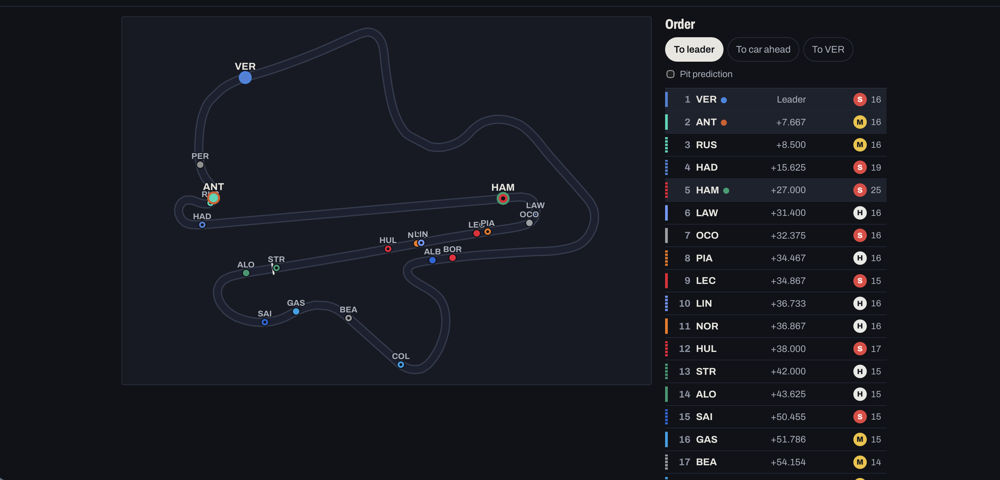
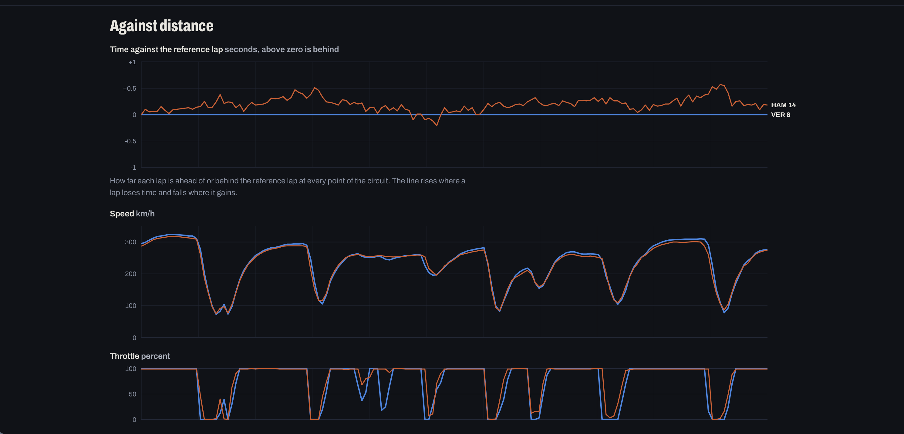
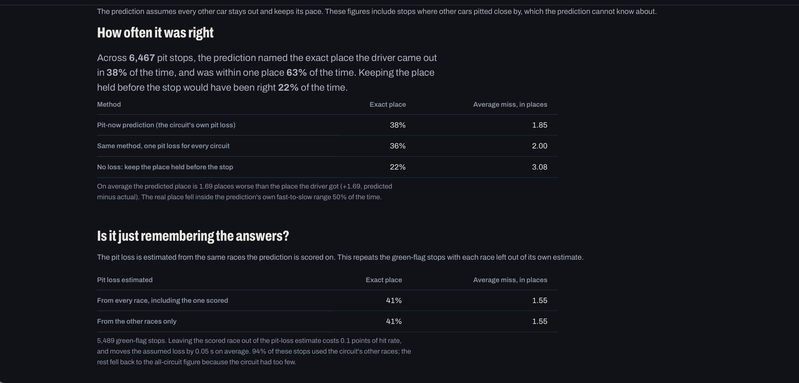
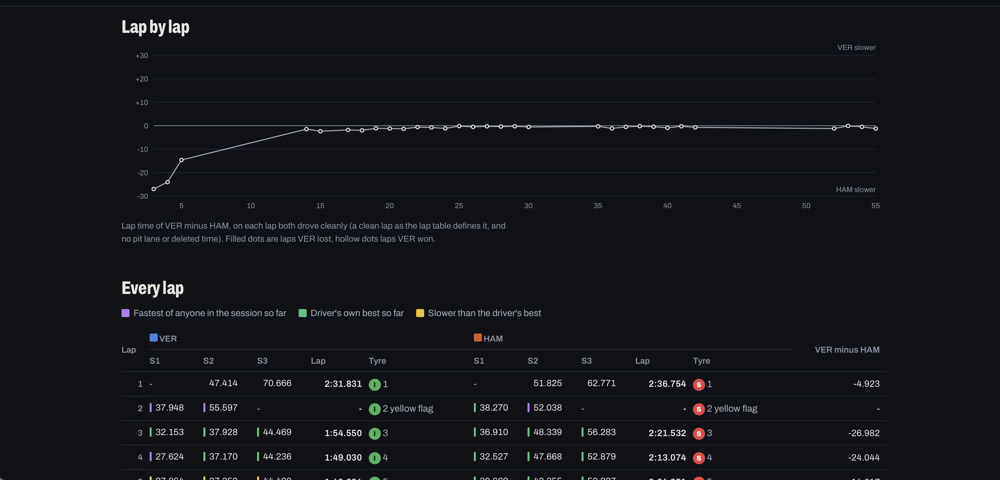

# F1 Pitwall


**How well can the numbers on an F1 timing screen be rebuilt from the raw feed, and how do we know?**
This project loads timing and GPS data for 2018 to 2026 into a Parquet lakehouse, models it with dbt on DuckDB,
rebuilds race order and pit-stop outcomes, and tests every derived number against something independent:
official sector timing, the official classification, real pit stops.



## Results

| Part | Result | Details |
|---|---|---|
| Ingest | 706 sessions, 2018-2026, about 1.8 GB of zstd Parquet. Every attempt is in an audit log; data contracts are checked on every table before it is written | [data.md](docs/data.md) |
| dbt on DuckDB | 57 models, 1 seed and 200 tests: 251 of 258 steps passed, 7 warnings, 0 errors. 26 gold models have enforced contracts; a documentation-coverage gate runs in CI | [dbt.md](docs/dbt.md) |
| Race-state engine | Running order rebuilt from GPS and checked against official sector timing on 135 sessions: median exact order 97.2% at the first sector line (85.9% for a last-lap baseline) and 99.7% at the second (86.1%). It fails at the second line at Baku and Suzuka | [engine-and-models.md](docs/engine-and-models.md) |
| Pit-stop predictor | Scored on races it was not fitted on: 41.1% exact place over 5,489 green-flag stops, and 79.4% on the 649 undisturbed stops, which are 12% of all stops | [apps.md](docs/apps.md) |
| Q&A agent | A local 14B model answering questions with SQL: 25 of 28 on questions written after the prompts were frozen, and it declined all 8 that the data cannot answer | [qa-agent.md](docs/qa-agent.md) |

## How it fits together

```
FastF1 (timing + telemetry) ──┐
                               ├─► ingest.py / batch.py ─► Parquet lake ─► dbt (DuckDB) ─► gold tables ─► Streamlit app
Jolpica API (1950-now) ───────┘      (rate-limit aware,     data/lake/      silver -> gold     contracts      (read-only)
                                      resumable, one          year=/round=/   + reconciliation   + tests
                                      session at a time)      session=/
                                           │
                                           └─► _manifest/*.jsonl (ingest log) ─► dbt run metadata, report.py, verify.py
```

| | |
|---|---|
| Sources | FastF1 3.8 (timing, telemetry), Jolpica (history) |
| Storage | Parquet (zstd) with Hive-style partitions, a JSONL ingest log |
| Transform | dbt-core with dbt-duckdb: 11 silver, 42 gold and 4 reconciliation models |
| Serving | Streamlit app, read-only FastAPI service, static Next.js site (replay, telemetry, predictor) |
| Orchestration | Airflow 3 in Docker Compose, one weekly DAG |
| Checks | pandera contracts at ingest, dbt tests and contracts, CI on a synthetic lake |

## Try it without any data

```bash
python dbt/ci/make_ci_lake.py ci_lake
F1_LAKE=ci_lake F1_DBT_DB=ci_lake/f1.duckdb dbt build --project-dir dbt --profiles-dir dbt
cd web && npm install && npm test
```

The full set-up (environments, ingest, app, API, Airflow) is in the [guide](docs/guide.md).

## Screenshots

| Telemetry against distance | Pit-stop predictor | Driver comparison |
|---|---|---|
|  |  |  |

## Limits

- **New sessions cannot be ingested right now.** Since about 15 October 2026 F1's timing archive wants a login. The data is complete through round 17 of 2026 and everything downstream works on it.
- **The pit-stop predictor gets the exact place right about four times in ten.** In most stops other cars are also pitting, and the model does not account for them.
- **Some results are unexplained, and publishing the derived JSON is an open question.** Both are written down: see [limits](docs/decisions-and-limits.md) and [data terms](docs/data-terms.md).

## More

| | |
|---|---|
| [Guide](docs/guide.md) | What it does, architecture, running it, repository layout |
| [Data](docs/data.md) | Coverage, ingestion, what the checks found in the raw feed |
| [dbt](docs/dbt.md) | Models, reconciliation, known data gaps |
| [Engine and models](docs/engine-and-models.md) | The race-state engine, pit loss, rejoin prediction, tyres, undercuts |
| [Apps](docs/apps.md) | Streamlit, the web app and replay, the API, Airflow |
| [Q&A agent](docs/qa-agent.md) | A local model answering questions in SQL, and how it was scored |
| [Decisions and limits](docs/decisions-and-limits.md) | Dead ends, limitations, roadmap |

## Notices

Unofficial: not associated with the Formula 1 companies. F1, FORMULA ONE, FORMULA 1, GRAND PRIX and related marks are trade marks of Formula One Licensing B.V.
Data comes from the public timing feed via [FastF1](https://github.com/theOehrly/Fast-F1) and the [Jolpica](https://github.com/jolpica/jolpica-f1) API. The raw data, the lake and the database are not in this repository.
It includes derived JSON that the web app reads, and I have not confirmed that publishing that is permitted ([data terms](docs/data-terms.md)). Personal, non-commercial use.
The code is MIT-licensed (see `LICENSE`); the licence covers the code only, not F1 data or marks.
