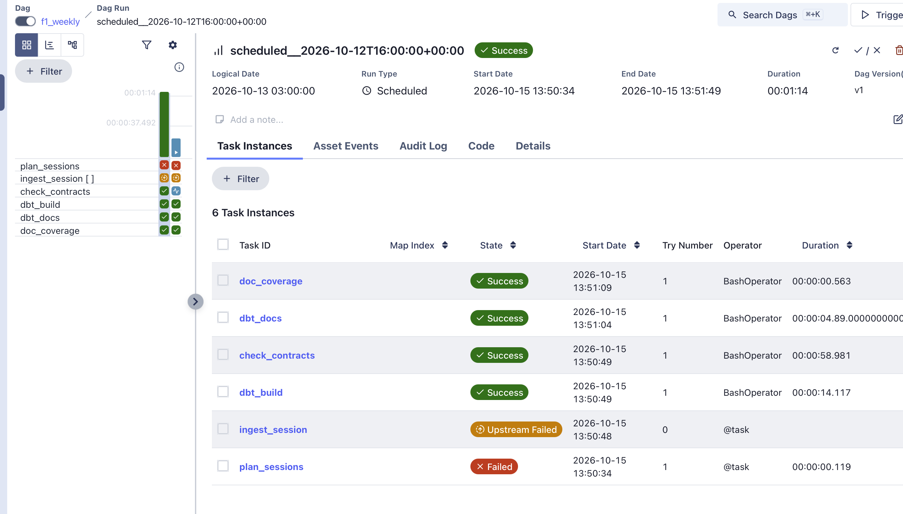
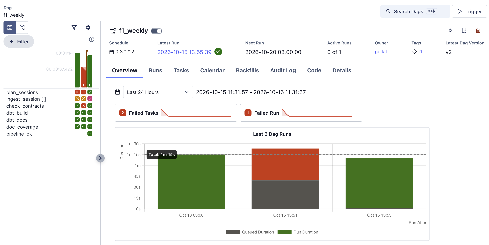

# The apps, the API and Airflow

[Back to the README](../README.md)

## The Streamlit app

| Page | What it does |
|---|---|
| Home | Coverage summary |
| Race explorer | Results, lap times with safety car / VSC / red shading and pit markers, tyre strategy, weather, race control |
| Track map | A lap coloured by speed, sector or throttle/brake, with corner numbers |
| Driver comparison | Two laps overlaid against distance with a time-gap trace |
| Season history | 1950-to-now seasons, drivers, teams, circuits |
| Race gaps | Positions, gap to leader, per-lap timing tower |
| Multi-driver telemetry | Up to six drivers, with DRS where it exists |
| Pit window | Predicted rejoin position and the cars around you, with the backtest figures |
| Race scrubber | All cars on the track at any moment; timing tower with sector colours; flags, weather and race control feed; follow drivers; auto-play 0.5x-60x |
| Session timing | Best laps, sectors and ideal lap for qualifying and practice |

## Web app

A static Next.js site in `web/`. It runs no analysis in the browser and needs no server: every number comes from
a dbt gold table, an exporter in `scripts/` writes it to JSON, and the page draws it. The calculations are tested
in Python (`tests/`) and the page logic with vitest (`web/tests`).

```
Parquet lake -> dbt gold tables -> scripts/export_*.py -> JSON in web/public/ -> static pages
```

| Page | What it shows | Built from |
|---|---|---|
| Race, Sessions, Circuits, Seasons | Results, stints, pit stops, per-circuit pit loss and tyre degradation, standings | `export_static.py`, `export_analysis.py`, `export_seasons.py` |
| Telemetry (`/telemetry`) | Up to eight laps of one session: speed, throttle, brake, gear and DRS against distance, with the time gap to a reference lap | `export_traces.py` |
| Drivers (`/compare`) | Lap-time gap between two drivers lap by lap, with purple, green and yellow sector colours | `fct_lap_sector`, `export_laps.py` |
| Predictor (`/predictor`) | The pit-stop rejoin prediction scored against what happened, including a held-out test | `fct_pit_prediction_*`, `export_predictor.py` |
| Practice (`/practice`) | Fastest laps and long runs in practice sessions | `export_laps.py` |
| Replay (`/replay`) | All cars on the track map with playback, corner numbers, marshal-sector flags, a leaderboard with gaps, tyre history and pit timers, a timing tower, driver telemetry cards, weather, flags and race control messages, for race, qualifying, sprint and sprint-qualifying sessions from 2022 (267 replays) | `export_replay.py` |

```bash
python scripts/export_static.py
python scripts/export_analysis.py
python scripts/export_seasons.py
python scripts/export_laps.py
python scripts/export_traces.py
python scripts/export_predictor.py
python scripts/export_replay.py  --sessions R,Q,S,SQ,SS
cd web && npm install && npm run dev      # npm run build writes the static site to web/out
```

`web/public/trace-data` (83 sessions, about 37 MB gzipped) and `web/public/replay-data` (about 500 MB) are
git-ignored and rebuilt with the exporters. The other JSON is committed. `export_replay.py --only 2026-R17-R
--force` rebuilds one session.

### Telemetry against distance

Every traced lap is resampled onto the same 160 distances from the line to the line, so two laps can be compared
point by point. Distance is built from the position (x, y) path, not read from the feed, so it is a measurement
and not an official figure. A lap gets a trace only if its telemetry covers the whole lap and its length matches
the track; the others are listed with the reason (standing start, pit lap, no telemetry, telemetry starting late
or ending early, a gap in the position feed, a track length that could not be established, a distance that does
not match the track). A lap whose speed channel disagrees with the positions is kept as time only (`speed_ok`
false): its time gap is drawn and its speed is not. Eight laps can be shown at once; that is a limit of the chart,
not of the data.

### Sector colours

`fct_lap_sector` colours every sector time of every lap, by the usual timing-screen rule applied to this lake:
purple if it beat every earlier time in that sector in the session (strictly), green if it beat the driver's own
earlier times, yellow otherwise. "Earlier" is by the moment the sector was completed (lap start plus the sectors
before it), not by lap number. Deleted laps and laps with a missing lap start or earlier sector get no colour.
Two tests guard the table: the status column is consistent with the times, and sector times add up to the lap
time. 97.7% of race laps keep all three sectors. 84 laps have sectors that do not add up to the lap time (most of
them in 2025 round 22 FP1 and the 2024 round 22 race); the test reports them and they are not hidden. The colours are
computed here from the lake. I have not compared them with the broadcast timing colours.

### Pit-stop predictor

At the end of the lap before a stop, the model predicts where the driver will be at the end of the out-lap: it
adds the circuit's typical pit loss to the driver's race time at the end of that lap and counts the cars that would
then be ahead. It is scored against the real position, with two baselines on the page: keep the same position,
and the same model with one global pit loss for every circuit.

Because the circuit's pit loss is estimated from the same races that are then scored, `fct_pit_prediction_heldout`
re-does the prediction for green-flag stops with each race left out of its own estimate (the circuit's median
loss from its other races when there are at least 10 stops from at least two other sessions, otherwise the global
median from other races). Two tests check that the held-out table recomputes the in-sample one when the race is
left in, and that the left-out race is never in its own estimate.

| Green-flag stops | Exact place, in-sample | Exact place, held out | Mean miss in places, in-sample | Mean miss, held out |
|---|---|---|---|---|
| All (5,489) | 41.2% | 41.1% | 1.553 | 1.554 |
| Undisturbed (649) | 79.7% | 79.4% | 0.308 | 0.307 |

The in-sample estimate was not flattering the score: leaving the race out cost about 0.1 point of exact hits, and
94% of stops had enough other races at the circuit to use the circuit's own figure. "Undisturbed" means green
flag and no other car pitting from one lap before to one lap after the stop. Only 649 of the 5,489 stops (12%)
are undisturbed. That is the real limit: in most stops other cars are also pitting, the model does not account for
them, and it gets the exact place right about four times in ten. On undisturbed stops 94% are within one place
(in-sample figure). Under a safety car the prediction is worse than guessing that the driver loses nothing. The
page splits the score by the margin to the nearest car (under 1 s, 1 to 3 s, over 3 s), so a close call can be
told from a safe one.

The earlier backtest in Strategy models (2,399 stops, 45.3% exact) selects its stops differently and its figure
is not directly comparable with the table above; I have not reconciled the two selections. Safety car and VSC
stops are not held out, and their pit loss is estimated across all races.

### Practice

Practice sessions are laps only (no telemetry). The page lists each driver's fastest laps and their long runs,
meaning runs with at least five clean laps, using the lap table's clean-lap flag, whose definition I have not
checked independently. Practice lap times are not comparable between cars: fuel load, engine mode and run plans are
unknown.

### Replay

Car positions are matched to the circuit outline, and progress is checked against the lap table at the end of
every lap; where a car is a whole number of laps out, it is put right using the lap table. Sessions it cannot do
honestly are skipped with a reason: 2026 round 6 (Monaco), where position data covers 5% of the race. 2026 round
11 (Hungary) is limited: its position feed stops matching the cars' clock from lap 7, and only 109 laps there have
traces. A few cars have position data that stops moving before the race ends (for example Russell in 2025 round
4), so their marker stands still while the leaderboard follows the lap table. The replay marks such a stretch: the dot is dashed and labelled "no position" and the leaderboard shows a !. Only one stretch in the 134 race replays meets the rule (two or more laps completed while the position stays still), so shorter freezes are not marked.

**What the page shows.** The leaderboard gives the gap to the leader and to the car ahead (an interval under a second is highlighted), each driver's earlier tyre compounds, a pit-lane timer while a car is in the pits, and a badge for the holder of the fastest lap so far. The timing tower has Gap and Int columns next to the sector colours, and the lap history tab has a chart of the gaps. The controls have 0.5x to 20x playback, skip buttons (including 5 minutes back and forward), a jump to a lap number, a progress bar shaded for yellow-flag, safety car, VSC and red-flag periods, and during a red flag a button that skips to the restart. A safety car or VSC makes the track edge pulse and labels the map; there is no safety car on the map, because the data has no position for it.

**Corner numbers and marshal sectors.** Corner numbers come from the lake's `circuit_corners` table and are placed on the drawn outline; a checkbox hides them. A marshal sector is the stretch of track from one marshal post to the next (`circuit_marshal_sectors`). While a message such as "YELLOW IN TRACK SECTOR 7" is in force, that sector is highlighted and tagged, yellow, or orange for a double yellow, until its "CLEAR" message. A corner is used only if it lies close to the drawn circuit, and the exporter drops all corners when a quarter or more are far away, and all marshal sectors when any post is far away or the posts do not run once around the lap in order, because a label in the wrong place is worse than none. That happens in nine replays from four weekends: 2022 round 21 has neither corners nor sectors, and 2022 round 18, 2023 round 16 and 2024 round 4 have no sectors. I did not look into why, and have not checked the sector highlights against the broadcast.

## The API

A small read-only FastAPI service (`api/main.py`) serves the gold tables as JSON, so anything that is not Streamlit can read the same numbers.

```
pip install -r requirements-api.txt
uvicorn api.main:app --port 8000      # interactive docs at http://localhost:8000/docs
```

| Endpoint | Returns |
|---|---|
| `/sessions`, `/sessions/{session_key}` | Sessions in the lake, filterable by year, round and session code |
| `/sessions/{session_key}/laps`, `/stints`, `/stint-degradation`, `/pit-stops`, `/race-control-periods` | The matching gold table for one session |
| `/circuits/pit-loss`, `/circuits/degradation` | Per-circuit tables; unreliable circuits are left out unless `reliable_only=false` |

How it behaves:

- The database is opened read-only on each request, so a running dbt build makes the API answer 503 until the build ends. `F1_API_DB` points it at another file.
- Every value from the URL goes in as a SQL parameter; table and column names are fixed in the code. `limit` accepts 1 to 5000.
- NaN and infinity come back as `null`.
- There is no authentication and no CORS configuration yet. It is meant to run on localhost; both come with deployment.
- The figures carry the same caveats as the gold tables: they are checked for internal consistency, not against an outside source.

`tests/test_api.py` runs against a small synthetic gold database, and includes a test that calls every endpoint on the real database when one is present. CI installs the API dependencies in a separate step.

## Orchestration (Airflow)

An optional Airflow 3 stack (Docker Compose, LocalExecutor, Postgres) schedules the same commands described above. It lives in `airflow/` and mounts the repository, so the DAG works on the real lake.




`f1_weekly` runs on Tuesdays at 03:00 Sydney time, after the weekend's sessions have finished:

```
plan_sessions -> ingest_session[ ] -+-> dbt_build -> dbt_docs -> doc_coverage -+-> pipeline_ok
                                    +-> check_contracts ----------------------+
```

- `plan_sessions` asks the ingest environment which sessions are finished but not yet in the lake, with the same rules as `batch.py` (earlier failed or partial sessions are skipped unless `retry_failed` is set).
- `ingest_session` is one mapped task per new session, in a pool with a single slot, so FastF1 is called one session at a time. FastF1's rate limit (500 calls per hour) is counted per process, so a rate limit fails the task and Airflow retries it up to four times, 20 minutes apart. An already-ingested session is skipped; a failed one is not retried.
- A failed run sends one push notification (ntfy) and appends a line to `airflow/logs/alerts.log`. Set `F1_ALERT_NTFY_TOPIC` in `airflow/.env` to turn the push on; without it only the log line is written. The alert was tested with a deliberately failing run.
- The dbt build, contract check and documentation gate run even if one session failed, so a single bad session does not stall the pipeline. `pipeline_ok` is the last task and turns the run red if anything upstream failed.
- Ingest and dbt run in separate virtual environments inside the image, installed from the same pinned constraints as CI.

```
cd airflow
cp .env.example .env      # fill FERNET_KEY and AIRFLOW__API_AUTH__JWT_SECRET, see airflow/README.md
docker compose build && docker compose up -d
# UI at http://localhost:8081 (local only; login airflow / airflow)
```

Tested so far: a manual run with nothing to ingest (all tasks green), the skip path against the real lake, and one real race ingested inside the container into a scratch directory. Not yet exercised on a live race weekend, so memory use during a telemetry ingest is unmeasured.
